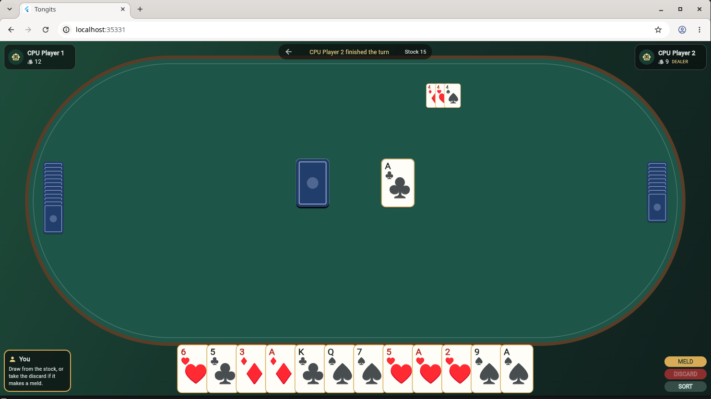
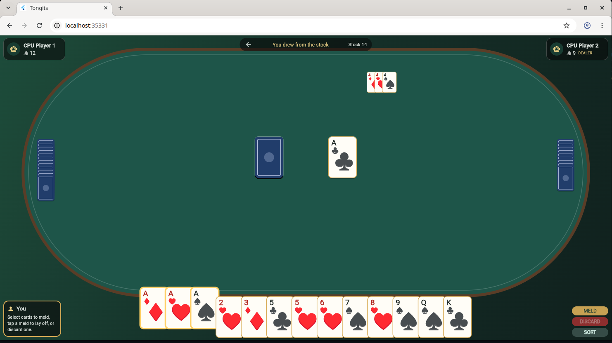
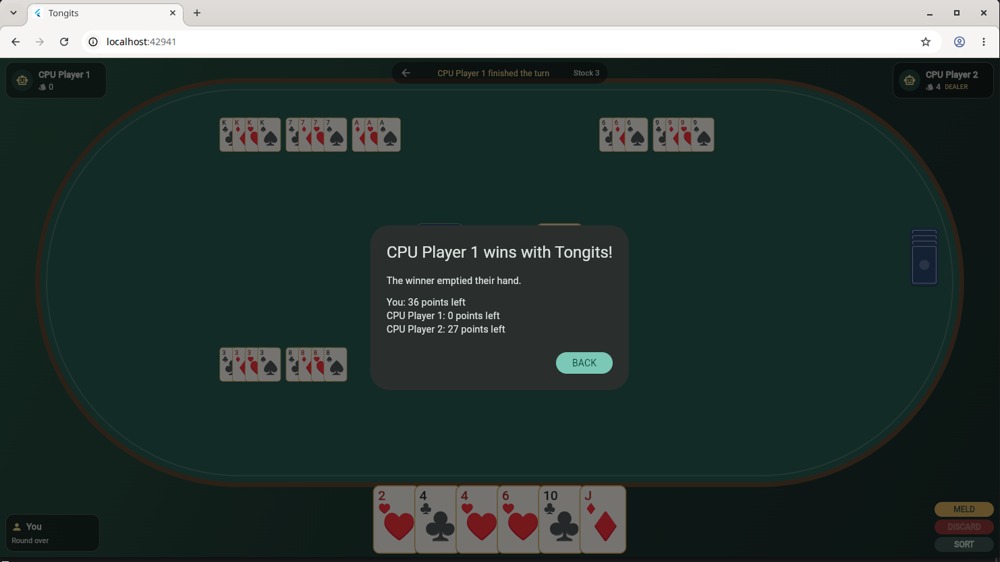

# 🃏 Filipino Tongits (Flutter)


> A single-player Tongits card game built with Flutter — face two CPU opponents in the classic Filipino rummy-style game of wits, *sapaw*, and *sablay*.

---

## 📖 Table of Contents

- [About the Game](#-about-the-game)
- [What made me develop this game?](#-what-made-me-develop-this-game)
- [Features](#-features)
- [Screenshots](#-screenshots)
- [Tech Stack](#-tech-stack)
- [Behind the Scenes (Tech Highlights)](#-behind-the-scenes-tech-highlights)
- [Getting Started](#-getting-started)
- [Project Structure](#-project-structure)
- [Roadmap](#-roadmap)
- [License](#-license)

---

## 🎮 About the Game

**Tongits** is a popular Filipino card game derived from rummy, played with a standard 52-card deck. The goal is to **meld** your cards into sets and runs, and be the first to **empty your hand** or **call "Tongits"** when you've exhausted the draw pile.

This project is a **single-player implementation** where you play against **two CPU opponents**, complete with:
- Full Tongits rule set (meld, sapaw, sablay, toma, draw/discard)
- AI-driven CPU decision-making
- Turn-based gameplay with animated card interactions
- Score tracking across rounds

---

## ❤️ What made me develop this game?

I built this not as a commercial product, but as a tribute to my niece.

When she was a little girl, we would spend hours playing Tongits together — she would shuffle the cards, argue about the rules, and celebrate every win like it was a championship. Now she's all grown up, and I wanted to preserve that memory in a form she can always return to.

This project is my way of capturing the nostalgia of those afternoons: the sound of cards slapping the table, the friendly trash talk, and the endless laughter when someone got caught with a *sablay*. It's a single-player Tongits game where you face two CPU opponents — just like how we used to play with her *uncle* and *uncle's cousin* filling in the other seats.

It's not just a game. It's a time capsule. ❤️

*— Geoff, developer*

---

## ✨ Features

- 🎴 **Complete Tongits rules** — melds, sapaw, sablay, toma, and scoring logic
- 🤖 **Two CPU opponents** with priority-based AI decision-making
- 🎯 **Single-player experience** — no network required
- 🃏 **Animated card interactions** and turn indicators
- 📊 **Round-by-round scoring** with win conditions
- 📱 **Responsive UI** — works on Android, iOS, and Web
- 🧪 **Unit tests** for scoring and win-condition logic *(update if applicable)*

---

## 📸 Screenshots

<!-- Replace with actual screenshots from your app -->
| Gameplay | Hand & Melds | Win Screen |
|----------|--------------|------------|
|  |  |  |

> **Tip:** Take 3–4 clean screenshots (dark mode + light mode kung meron) at ilagay sa `/screenshots` folder.

---

## 🛠 Tech Stack

| Layer | Technology |
|-------|------------|
| Framework | Flutter `<version>` |
| Language | Dart `<version>` |
| State Management | `<e.g., Provider / Riverpod / Bloc / setState>` |
| Testing | `flutter_test`, `<mockito kung meron>` |
| CI/CD | `<GitHub Actions kung meron>` |
| Platform | Android, iOS, Web |

---

## 🔍 Behind the Scenes (Tech Highlights)

This project demonstrates several software engineering concepts beyond basic UI:

- **Game Engine:** Built with Flutter/Dart, implementing full Tongits rules — including *sapaw*, *sablay*, *toma*, and scoring logic.
- **AI Opponents:** Two CPU players use a priority-based decision model that evaluates hand strength, discard risk, and opponent behavior.
- **State Management:** Centralized game state with deterministic transitions, ensuring consistent rule enforcement across rounds.
- **Modular Architecture:** Clear separation between game rules (`/lib/game`), UI (`/lib/screens`), and models (`/lib/models`) — making the codebase easy to extend and test.
- **UI/UX:** Smooth card animations, turn indicators, and a responsive layout that mimics the tactile feel of a physical card table.
- **Code Quality:** `<Unit tests for scoring and win-condition logic / Linting via flutter_lints / etc.>`

---

## 🚀 Getting Started

### Prerequisites

- Flutter SDK `>=3.x` — [Install Flutter](https://docs.flutter.dev/get-started/install)
- Dart `>=3.x`
- Android Studio / Xcode / Chrome (for web)

### Installation

```bash
# 1. Clone the repository
git clone https://github.com/geoffembuscad0/filipino-tongits-flutter.git
cd filipino-tongits-flutter

# 2. Install dependencies
flutter pub get

# 3. Run the app
flutter run
